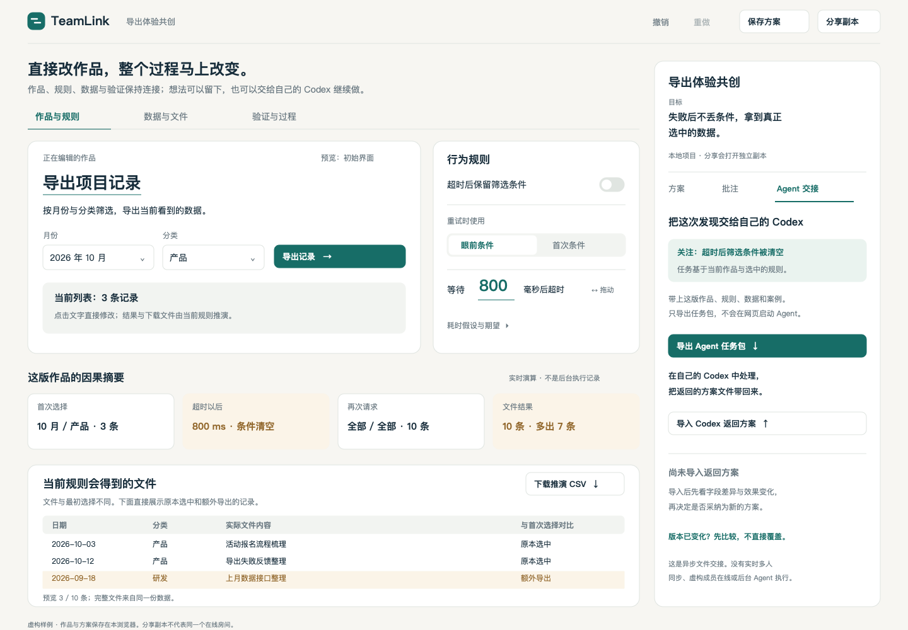

# GatherThread 对照：把作品、方案与 Agent 交接连起来

TeamLink 应借鉴 GatherThread 的项目脉络和显式 Agent 请求边界，同时保留可执行作品作为中心。一次修改必须继续驱动真实预览、请求参数、验证结果与 CSV，不能只更新聊天、文件标题或固定模板。

本次依据是 GatherThread 公开示例截图、官网及固定提交源码，与 TeamLink 当前页面截图和实现。没有验证 GatherThread 正式账号下的真人协作或 Agent 后端运行。以下记录对照与实现取舍；实际验证见 [验证记录](VERIFICATION.md)。

目录：[对照](#对照结论) · [最小体验](#最小完整体验) · [边界与验证](#边界与验证) · [来源](#来源)

## 对照结论

GatherThread 的正式项目含共享状态和真实执行基础设施：SQLite 有序事件日志、HTTP/WebSocket 同步、本地 Codex 连接器、独立文件工作区，以及带预算和来源校验的串行 Agent 团队。公开 example 的固定预览只是免登录示例的边界，不能由此推断正式产品没有执行能力。本轮从源码确认这些机制，没有用正式账号验证线上执行。

TeamLink 本轮完成的是围绕成果的即时编辑和异步提案审阅。多人共享持久化、连接每位成员的 Agent、成员权限和自动平台同步仍需后续建设，尚不能替代 GatherThread 的整套协作基础设施。

| 观察 | 对 TeamLink 的启发 | 本轮取舍 |
| --- | --- | --- |
| 公开示例有命名项目、共享会话、项目文件和成果入口 | 修改需要属于一个项目，并能留下讨论与方案脉络 | 增加项目名、目标、命名方案和定点批注 |
| “发送 chat”与“请求我的 Agent”分开；前者明确标注只共享、不运行 Agent | 发言不等于授权执行，也不能把共享会话当作个人 Agent 的私聊 | Agent 交接保持显式：导出任务包，在本人的 Codex 处理，再导入方案 |
| 示例预览按提交选择预置模板；源码明确提示“编辑文件不会改变此预览” | 文件入口与可操作预览并不自动构成同一件作品 | 保留 TeamLink 同一文档模型，预览和文件都由实际规则与数据推导 |
| TeamLink 优化前把数据、情境、期望、过程和文件铺成长页；修改与反馈容易分离 | 信息虽完整，创作者仍需来回找结果 | 采用三种工作视图，并持续保留因果摘要和附近的文件结果 |

参考截图中的中心是会话消息流。本轮继续让作品占据主要空间：项目协作收进侧栏，不把直接编辑的作品降成聊天里的附件。

## 最小完整体验

设计稿：[可编辑 SVG](../design/gatherthread-v3.svg) · [PNG 预览](../design/gatherthread-v3.png)。1440 × 1000；无向导、角色门禁或虚构 Agent 在线状态。

中央提供“作品与规则 / 数据与文件 / 验证与过程”。这些是同一作品的视图，切换不推进流程，也不改变模型。即时因果摘要和当前文件结果留在附近；编辑数据时仍能看见条数、耗时和导出范围怎样变化。

右侧以“方案 / 批注 / Agent 交接”组织项目上下文：

- **方案**：给当前作品命名保存，保留独立快照；比较与恢复均明确操作，不让旧对照跟着当前修改。
- **批注**：绑定具体对象及版本，例如“超时后筛选被清空”；普通批注不自动改规则，也不触发 Agent。
- **Agent 交接**：导出当前作品、关注对象、规则、数据和案例；用户在真实外部 Codex 中处理，再手动导入返回方案。先看字段差异及实际效果预览，再决定是否采纳。

返回方案必须声明基于哪一版。当前作品已变化时显示冲突，禁止无条件覆盖。候选方案的效果预览调用同一计算模型；“导入成功”“预览符合预期”和“人已采纳”分别表达，不混成已完成研发或业务验收。

## 边界与验证

当前是本地项目与异步副本协作：作品、方案和批注保存在浏览器，分享打开可继续编辑的独立副本。没有同一房间的多人实时同步、成员在线或自动合并；未来实现这些能力需要共享持久化和冲突协议。

导出任务包不会在网页中启动 Agent；导入文件也不能证明作者身份、实际执行过代码或通过真实 CI。导入内容作为数据校验，不作为可执行代码运行。页面不读取私人 Codex 会话、凭据或真实团队材料。

实现后至少核对：

- 同一字段修改立即影响预览、轨迹和实际下载文件；无效输入保持原有效作品。
- 切换视图保留作品和编辑位置，数据编辑时仍能看到变化结果；手机保留简洁结果摘要。
- 命名快照不随当前作品改变；恢复、比较、撤销与重做保持含义一致。
- 批注定位到对象，找不到旧版本对象时明确提示，不悄悄指向另一处。
- 导出任务包能由外部 Codex 读取；返回候选方案可以预览效果，过时基线不能直接采纳。
- 页面不把本地批注、分享副本或手动导入标成真人协作、Agent 正在运行或真实检查通过。

## 来源

- [GatherThread 官网](https://gatherthread.cn/)；[仓库固定提交](https://github.com/TH060419/gatherthread/tree/ec69adac29a83f493a4ed3b3465e869425b052a6)。
- [预置示例预览实现，第 54–67 行](https://github.com/TH060419/gatherthread/blob/ec69adac29a83f493a4ed3b3465e869425b052a6/apps/web/src/example-project-view.js#L54)：读取快照后以 `snapshot.commit` 判断模板，调用 `examplePreviewDocument(locale(), improved)`；提示编辑文件不改变此预览。
- [有序共享事件与幂等提交](https://github.com/TH060419/gatherthread/blob/ec69adac29a83f493a4ed3b3465e869425b052a6/apps/server/src/database.ts#L4968)、[实时事件补齐](https://github.com/TH060419/gatherthread/blob/ec69adac29a83f493a4ed3b3465e869425b052a6/apps/web/src/realtime.js#L164)、[本地 Codex 执行器](https://github.com/TH060419/gatherthread/blob/ec69adac29a83f493a4ed3b3465e869425b052a6/packages/bridge/src/codex-executor.ts#L141)、[有界 Agent 团队](https://github.com/TH060419/gatherthread/blob/ec69adac29a83f493a4ed3b3465e869425b052a6/apps/server/src/agent-teams.ts#L400)。
- [Apache-2.0 许可证](https://github.com/TH060419/gatherthread/blob/ec69adac29a83f493a4ed3b3465e869425b052a6/LICENSE)、[NOTICE](https://github.com/TH060419/gatherthread/blob/ec69adac29a83f493a4ed3b3465e869425b052a6/NOTICE)：若后续复制源码，需要按许可证保留适用声明；本轮未复用源码或品牌素材到应用。
- [GatherThread 公开示例截图](../design/references/gatherthread-example.png)：项目、会话、成果入口与分开的 chat / Agent 请求操作。
- [TeamLink 当前公开页面截图](../design/references/canvas-before-v3.png)、[页面结构](../dist/index.html)、[可执行文档模型](../dist/canvas-model.mjs)、[现有体验边界](EXPERIENCE.md)。截图为本轮优化前的观察快照，实际实现与上线状态以最新验证记录为准。

本轮只借鉴交互与结构，未复制 GatherThread 源码。Figma 通道仍受额度限制，本轮未重试；交付为独立可编辑 SVG 与实际渲染预览。
